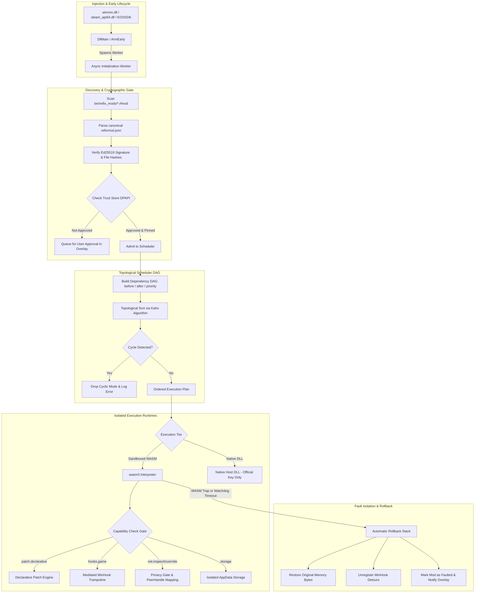

# ReFix Mods Runtime & Subsystem Architecture Specification

**Document Version:** 1.0.0  
**Status:** Canonical Implementation Specification  
**Scope:** ReFix LAN (branch `refix_lan`)  
**Implementation Files:**
- Subsystem Core: `src/mods/mod_host.h/.cpp`
- Manifest Validator: `src/mods/mod_manifest.h/.cpp`
- Cryptographic Engine: `src/mods/mod_signature.h/.cpp`, `src/mods/crypto/`
- Archive & Packaging: `src/mods/mod_package.h/.cpp`, `src/mods/miniz/`
- Trust Store: `src/mods/mod_trust_store.h/.cpp`
- Topological Scheduler: `src/mods/mod_scheduler.h/.cpp`
- WebAssembly Sandbox: `src/mods/sandbox_wasm.h/.cpp`, `src/mods/wasm3/`
- Declarative Patch Engine: `src/mods/patch_engine.h/.cpp`
- Privacy Gate: `src/mods/privacy_gate.h/.cpp`
- Native Host: `src/mods/native_host.h/.cpp`
- Adapters: `src/mods/adapters/engine/`, `src/mods/adapters/protocol/`
- Overlay UI: `src/overlay/overlay_ui_mods.h/.cpp`

---

## 1. Subsystem Architecture Overview

The ReFix Mods subsystem coordinates the discovery, verification, scheduling, execution, and isolation of game plugins inside the host game process.



---

## 2. Loader Lock Avoidance & In-Memory Lifecycle

### 2.1 The Loader Lock Constraint
During Windows dynamic library loading, the operating system holds a process-wide mutex known as the **Loader Lock**. Executing synchronization primitives, network operations, disk I/O, or spawning threads from within `DllMain` while holding the loader lock risks deadlocks and undefined behavior.

### 2.2 ReFix Early Arming Strategy
1. **`DllMain` Actions (Strictly Minimal):**
   - Captures proxy module handle.
   - Sets lightweight environment variables (`NvidiaReflexBlock::ArmEarly()`).
   - Spawns a dedicated worker thread via `CreateThread` and exits `DllMain` immediately.
2. **Asynchronous Subsystem Initialization:**
   The background worker thread initializes `ModHost`:
   - Scans the `refix_mods/` directory.
   - Decrypts the DPAPI trust store (`%APPDATA%\ReFix\mods\trust.json`).
   - Detects the game engine (Mono, IL2CPP, Unreal, etc.) via `EngineAdapter::Detect()`.
   - Advances lifecycle phases deterministically as the game process completes startup.

---

## 3. The DAG Topological Scheduler

Mod execution is ordered across 11 discrete phases:
`Boot`, `PreRefix`, `PostRefix`, `GameInit`, `EngineReady`, `NetworkReady`, `PreFrame`, `PostFrame`, `LobbyJoined`, `MatchStart`, `Shutdown`.

### 3.1 Ordering Rules Within a Phase
Within any given phase, the execution order is determined by a Directed Acyclic Graph (DAG):
1. **Explicit Edges (`before` / `after`):**
   - If Mod $A$ declares `"after": ["ModB"]`, a directed edge $B \rightarrow A$ is added.
   - If Mod $A$ declares `"before": ["ModC"]`, a directed edge $A \rightarrow C$ is added.
2. **Priority Tie-Breaking:**
   For nodes with equal graph dependency depth, priority values are used (higher priority runs first).
3. **Topological Sorting (Kahn's Algorithm):**
   - Compute in-degrees for all mod nodes.
   - Seed queue with nodes having in-degree 0, sorted by priority.
   - Iteratively extract node $u$, append to execution schedule, and decrement in-degrees of successors.
4. **Cycle Detection:**
   If the number of visited nodes upon queue exhaustion is less than the total node count, a cyclic dependency exists. ReFix identifies the cycle components, drops the offending mods, and logs a descriptive diagnostic message without stalling the game.
5. **Requirement & Conflict Verification:**
   - Any mod whose `"requires"` list contains missing or disabled mods is pruned.
   - Any mod whose `"conflicts"` list matches an active mod is deactivated.

---

## 4. WebAssembly Sandboxing & Runtime Engine

### 4.1 Interpreter Configuration
- Sandboxed mods execute using a statically compiled `wasm3` runtime (`src/mods/wasm3/`).
- Native compilation flags include `/Zc:preprocessor` to ensure standard conformance under MSVC.
- Stack size is bounded to 64 KB per sandbox instance.
- Linear memory page limit is bounded by `resource_limits.max_memory_mb` (default 16 MB).

### 4.2 Host Capability Gate
When a WASM module invokes a host import function, the call passes through a validation macro:

```cpp
#define REQUIRE_CAPABILITY(cap) \
    if (!HasCapability(cap)) { \
        refix::Log(REFIX_LOG_WARN, "Mod '%s' attempted call without capability '%s'", \
                   mod_id_.c_str(), cap); \
        return REFIX_ERROR_PERMISSION_DENIED; \
    }
```

Calls lacking approval fail immediately, returning `REFIX_ERROR_PERMISSION_DENIED` to the mod.

### 4.3 High-Resolution Watchdog
Every host-to-WASM transition is wrapped with a hardware timer check (`QueryPerformanceCounter`):
- If the callback execution time exceeds `watchdog_timeout_ms` (default 15 ms), the watchdog triggers.
- The WASM runtime is instructed to halt execution.
- The mod is transitioned to the `Faulted` state.

---

## 5. Declarative Patch Engine & MinHook Mediation

### 5.1 Declarative Patch Execution
1. **Module Resolution:** Resolves target module base address (`GetModuleHandleA`).
2. **Blacklist Check:** Rejects system modules (`kernel32`, `ntdll`, `user32`, `ws2_32`) and ReFix core DLLs.
3. **Expected Byte Verification:** Compares memory at `ModuleBase + RVA` against `expected_bytes`.
4. **Guarded Memory Write:**
   - Adjusts page protection using `VirtualProtect` to `PAGE_EXECUTE_READWRITE`.
   - Copies `new_bytes`.
   - Restores original page protection.
   - Flushes CPU instruction cache using `FlushInstructionCache(GetCurrentProcess(), address, len)`.
5. **Rollback Registration:** Appends `{ address, original_bytes, len }` to the mod's rollback stack.

### 5.2 Mediated MinHook Trampolines
1. Rather than accepting a native function pointer from a mod, the mod specifies the target function address (RVA or pattern) and a WASM export function index.
2. ReFix generates an internal C++ bridge trampoline.
3. When the game calls the target function, the bridge intercepts execution, captures parameters, executes the sandboxed WASM callback within the watchdog harness, and returns to the original game function via MinHook's trampoline.

### 5.3 SEH and Anti-ROP Verification
Direct memory writes (`host->memory_write`) are protected against Return-Oriented Programming (ROP) exploitation:
- Every 32-bit and 64-bit value in the write buffer is inspected using `VirtualQuery`.
- If a value points into an executable section (`MEM_IMAGE`, `PAGE_EXECUTE_READ`) of any operating system DLL, the write is rejected.
- To prevent access violations when inspecting invalid memory regions, inspection is wrapped in Structured Exception Handling (`__try` / `__except`) isolated inside a static helper function (`SafeCheckPeHeaders`) to avoid MSVC C2712 destructor conflicts.

---

## 6. The Privacy Gate & Ephemeral Peer Handles

The Privacy Gate translates between low-level network identities and sandboxed mod code:

```
[lan_core / Transport Mesh]
    │ Real Endpoint: 192.168.1.45:47584
    │ Real SteamID:  76561198511814903
    ▼
[PrivacyGate::GetOrCreatePeerHandle(mod_id, real_id)]
    │ HMAC-SHA256(SessionSalt ^ SHA256(mod_id), real_id)
    ▼
[Sandboxed WASM Mod]
    │ Receives: PeerHandle = 0xc8b4da7db14955e8
    │ Display Name: "Player_55e8" (Redacted unless players.display_name granted)
    │ Physical IP: NEVER EXPOSED
```

---

## 7. Trust Store & DPAPI Persistence

The user trust database is maintained at:
`%APPDATA%\ReFix\mods\trust.json`

### 7.1 Cryptographic Storage Format
```
[4-byte Magic: 'RFTR']
[4-byte Version: 0x00010000]
[32-byte HMAC-SHA256 Authentication Tag]
[DPAPI Encrypted Blob (CryptProtectData)]
```

### 7.2 TOFU Workflow
1. When a community mod is first loaded, `ModTrustStore::Evaluate()` checks if `author_pubkey` is recorded.
2. If absent:
   - Mod is placed in `PendingApproval` state.
   - Interactive prompt modal is surfaced in the ReFix in-game overlay.
3. When user clicks **"Approve"**:
   - The public key is pinned to the mod ID.
   - The granted capability list is stored.
   - The trust store is re-encrypted with DPAPI and saved.
4. On subsequent boots:
   - If the mod's public key matches and no new capabilities are requested, admission is automatic.
   - If an update changes the public key or requests additional capabilities, re-approval is required.

---

## 8. Thread Safety & Concurrency

- **`ModHost` Global State:** Protected by standard Windows `CRITICAL_SECTION` locks.
- **WASM Callbacks:** Execution is single-threaded per sandbox instance to eliminate race conditions within interpreted WebAssembly linear memory.
- **Network Packet Hooks:** Packet filtering occurs in-line on the network reactor thread. If a mod's packet filter exceeds its time budget, the packet is forwarded unchanged to avoid stalling gameplay network loops.
