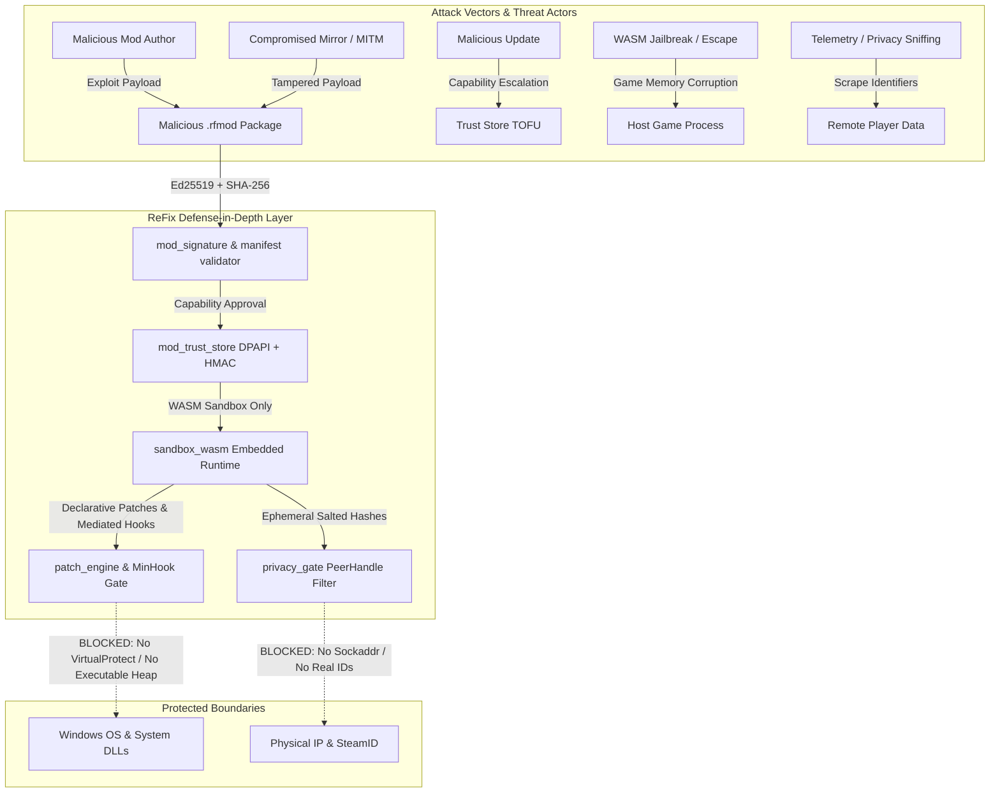
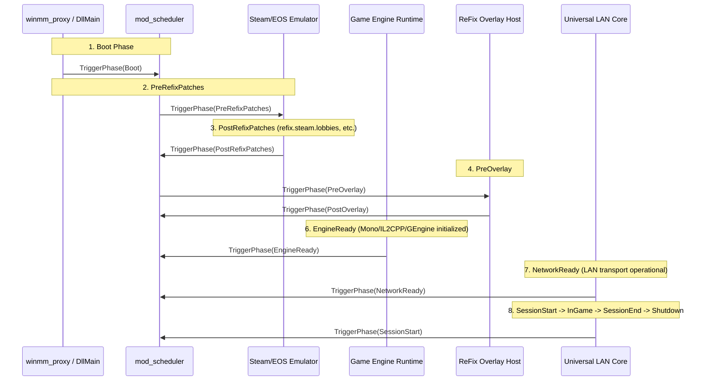

# ReFix Mods SDK & Runtime Architecture Specification
**Document Version:** 1.0.0  
**Status:** Architecture Proposal & Design Baseline  
**Scope:** ReFix LAN (branch `refix_lan` / standalone edition)  
**Authors:** ReFix Core Systems Engineering Team  

---

## 1. Executive Summary & Vision

ReFix Mods is a secure, isolated, deterministic modding SDK and runtime engine embedded within the ReFix LAN compatibility layer. It enables community developers and game preservationists to author game-specific plugins—including declarative byte patches, engine-level mediated hooks, protocol overrides, network adapters, and custom overlay interfaces—without risking user host security or violating player privacy.

### Key Architectural Pillars:
1. **Zero-Trust Community Execution:** Community mods execute exclusively inside an embedded WebAssembly (WASM) sandbox with strict memory bounding, instruction watchdogs, and capability gating. No community code ever executes as raw native machine code.
2. **Absolute Player Privacy (Requirement S1):** Remote players are exposed exclusively as opaque, double-salted ephemeral `PeerHandle` identifiers. Physical network addresses (IPv4, ports, MAC), hardware GUIDs, real SteamIDs, and EOS IDs never cross the mod boundary.
3. **Cryptographic Provenance (Requirement S3):** Packages (`.rfmod`) are cryptographically sealed with Ed25519 signatures and per-file SHA-256 manifests. A dual-tier chain of trust (Offline Root Key $\rightarrow$ Intermediate Developer Certificates $\rightarrow$ User Trust-On-First-Use) governs mod admission.
4. **Deterministic Topological Scheduling:** Lifecycle execution is organized into discrete engine and network phases. Inter-mod dependencies, priorities, and internal ReFix hook anchors are resolved via directed acyclic graph (DAG) topological sorting with cycle rejection.
5. **Universal Engine & Protocol Layering:** Abstract adapter interfaces decouple game modifications from underlying runtimes (Unity Mono, Unity IL2CPP, Unreal Engine 4/5, Godot, Source/Source 2, GameMaker, Custom) and protocols (Steam Networking, EOS, Photon, ReFix LanCore, Raw Sockets).
6. **Inert Baseline:** When mods are disabled or none are installed, the runtime remains 100% inert, consuming zero CPU cycles and altering no game behavior.

---

## 2. Threat Model & Security Architecture

### 2.1 Threat Actors & Attack Vectors



### 2.2 Threat Classification & Mitigations

#### Threat 1: Malicious Mod Author (Community Malware)
* **Objective:** Execute arbitrary code on the player's system (ransomware, stealer, botnet).
* **Mitigation:**
  * Strict prohibition of native community DLLs. All community mods are compiled to WebAssembly (WASM) and executed via an embedded WASM engine (WAMR / wasm3).
  * The WASM runtime is built with **zero WASI filesystem and zero WASI network** support.
  * The mod cannot make Win32 API calls, open files outside its sandboxed storage quota, spawn processes, or allocate system sockets.

#### Threat 2: Tampered Package (Man-in-the-Middle or Modified Mirror)
* **Objective:** Alter legitimate mod code or inject malicious assets into a trusted package.
* **Mitigation:**
  * Package container `.rfmod` (ZIP format) must contain a canonical `refixmod.json` manifest, file payloads, and a detached signature `refixmod.sig`.
  * The manifest specifies the exact SHA-256 hash of every single file in the archive.
  * `refixmod.sig` is an Ed25519 signature over the canonical manifest bytes.
  * If any file is missing, altered, or unlisted in the manifest, or if zip extraction encounters path traversal attacks (`..` or absolute paths), the package is immediately rejected.

#### Threat 3: Malicious Update & Capability Escalation
* **Objective:** An author releases a benign mod to gain approval, then pushes an update requesting dangerous capabilities (`memory.write`, `players.display_name`) or signs with a different key.
* **Mitigation:**
  * **Trust-On-First-Use (TOFU) Pinning:** The author's Ed25519 public key fingerprint is pinned upon initial user approval in `%APPDATA%\ReFix\mods\trust.json`.
  * If an update is signed by a different key, approval is immediately invalidated.
  * If an update introduces any new capability (even if signed by the same key), ReFix halts mod execution and prompts the user with an explicit diff of newly requested permissions.
  * The trust store itself is encrypted with DPAPI and integrity-protected via HMAC-SHA256 to prevent out-of-band tampering.

#### Threat 4: Sandbox Escape via Game Memory Escalation
* **Objective:** A sandboxed WASM mod manipulates the game process heap/code to trigger native shellcode execution or bypass sandbox constraints.
* **Technical Reality Assessment:** Inside a shared process address space, an unrestricted native pointer write could theoretically overwrite function pointers or return addresses. ReFix enforces five strict technical barriers:
  1. **No Direct Code Modification:** Mods cannot call `VirtualProtect`, cannot allocate `PAGE_EXECUTE_READWRITE` memory, and cannot write to executable sections.
  2. **Declarative Code Patches Only:** Code patches are submitted as structured definitions: `{ module, rva_or_pattern, expected_original_bytes, patch_bytes }`. ReFix inspects the target module. The module **must belong strictly to the game or engine binary**; ReFix categorically rejects patches targeting `ntdll.dll`, `kernel32.dll`, `kernelbase.dll`, `ws2_32.dll`, `user32.dll`, graphics drivers, or ReFix's own DLLs. ReFix verifies that `expected_original_bytes` match memory exactly before briefly flipping page protections, applying the patch, and restoring the original protection.
  3. **Mediated Hooks via MinHook:** Mods never register native function pointers as hook callbacks. The mod registers a hook target and a declared WASM export function signature. ReFix installs an internal native trampoline that marshals arguments, invokes the WASM callback through the runtime sandbox, catches traps, and returns safely.
  4. **Restricted Data Memory Writes:** Writes to data memory require the `memory.write` capability (flagged as High Risk in the UI). ReFix validates write targets against forbidden regions: ReFix internal state structures, PE Import Address Tables (IAT), Export Address Tables (EAT), system module vtables, and writes containing pointer values that point into executable sections of system DLLs (pointer hijacking mitigation).
  5. **Resource Watchdog & Trap Rollback:** Each callback execution is governed by a cycle/time watchdog (default: 10ms budget). If a mod triggers an infinite loop or WASM trap (e.g. division by zero, out-of-bounds linear memory access), ReFix immediately traps, unloads the mod, rolls back all of its declarative patches and MinHook trampolines, and logs the incident without crashing the game.
* **Honest Security Disclosure:** While these barriers eliminate standard code injection and privilege escalation vectors, arbitrary writes to game data memory can still destabilize game logic or cause desynchronization. Therefore, `memory.write` is classified as High Risk and highlighted with visual warnings during user approval.

#### Threat 5: Player Data Exfiltration & Tracking (Requirement S1)
* **Objective:** A mod collects IP addresses, SteamIDs, or MAC addresses to doxx players, coordinate DDoS attacks, or track player movement across servers.
* **Mitigation:**
  * **Zero Real Identifiers:** Mods never receive or query IP addresses, ports, MAC addresses, hardware fingerprints, real SteamIDs, or EOS ProductUserIds.
  * **Double-Salted Ephemeral `PeerHandle`:**
    $$\text{PeerHandle} = \text{Truncate}_{64}\Big(\text{HMAC-SHA256}\big(\text{SessionSalt} \oplus \text{ModSalt},\; \text{RealPeerID}\big)\Big)$$
    A fresh cryptographically secure random 256-bit salt is generated for each game session and mod instance. Mod A and Mod B inside the same session see different `PeerHandle` values for the same remote player. The identifier changes completely upon game restart.
  * **Transport Boundary:** Network APIs exposed to mods operate strictly on `(PeerHandle, channel_id)`. The mod cannot interact with `sockaddr_in` or low-level sockets. Migrating to P2P transport requires zero modifications to mod code.
  * **Payload Scoping:** Mods can only inspect or modify payload data on channels explicitly declared in their manifest. Transport framing, encryption headers, ReFix identity beacons, and overlay traffic (presence, invitations, profile sync) are strictly quarantined from mod access.
  * **Player Display Names:** Player names are masked unless the mod declares the `players.display_name` capability and the user approves it.

---

## 3. Two-Tier Execution Model

| Dimension | Tier 1: Sandboxed (Community) | Tier 2: Native (Official ReFix Only) |
| :--- | :--- | :--- |
| **Target Audience** | Community authors, modding platforms | ReFix Core Team, official game preservation fixes |
| **Binary Format** | WebAssembly bytecode (`.wasm`) | Native Windows PE Dynamic Link Library (`.dll`) |
| **Runtime Environment**| Embedded WASM VM (WAMR / wasm3) | In-process native execution via C ABI |
| **Signing Authority** | Author key (verified or unverified) | ReFix Official Root / Intermediate Private Key |
| **User Approval** | Manual approval with capability prompts | Automatic verification via embedded public key |
| **Memory Isolation** | Strict WASM linear memory sandbox | None (runs in game address space) |
| **Code Modification** | Declarative byte patches (validated by host) | Full native patching & hooks |
| **File / OS Access** | Quota-governed virtual folder only | Controlled by signed official binaries |
| **Crash Protection** | WASM Trap catch $\rightarrow$ auto-unload & rollback | Subject to game process lifecycle |

> [!CAUTION]
> Under no circumstances can a community mod be executed as a native DLL. Manual user approval UI will categorically reject any attempt to load an unsigned or third-party native DLL.

---

## 4. Cryptographic Trust Chain & Package Specification

### 4.1 Cryptographic Primitives
* **Signatures:** Ed25519 (Edwards-curve Digital Signature Algorithm, RFC 8032) via statically linked Monocypher / libsodium.
* **Hashing:** SHA-256 for file contents and canonical manifest verification.
* **Integrity & Secrecy:** DPAPI (`CryptProtectData`) combined with HMAC-SHA256 for local user trust storage.

### 4.2 Hierarchy of Trust

```
                      +-----------------------------+
                      |   ReFix Root Authority      |
                      |   (Offline Cold Storage)    |
                      +-----------------------------+
                                     |
               +---------------------+---------------------+
               |                                           |
               v                                           v
+-------------------------------+           +-------------------------------+
| ReFix Official Release Key    |           | ReFix Developer CA Key        |
| (Signs Official Native Mods)  |           | (Signs Verified Author Certs) |
+-------------------------------+           +-------------------------------+
               |                                           |
               v                                           v
+-------------------------------+           +-------------------------------+
| Tier 2: Native DLL Mods       |           | Tier 1: Verified Community    |
| (Executes without prompts)    |           | (Pre-verified author identity)|
+-------------------------------+           +-------------------------------+
                                                           |
                                            +--------------+--------------+
                                            |                             |
                                            v                             v
                             +-----------------------------+ +-----------------------------+
                             | Tier 1: Verified Community  | | Tier 1: Self-Signed Community |
                             | (Prompts on new caps only)  | | (Prompts TOFU & High Risk)  |
                             +-----------------------------+ +-----------------------------+
```

### 4.3 Package Layout (`.rfmod`)
An `.rfmod` file is a ZIP archive containing:
```
example_mod.rfmod
├── refixmod.json         # Canonical JSON manifest (versioned schema)
├── refixmod.sig          # Ed25519 signature over canonical refixmod.json
├── mod.wasm              # Compiled WASM module (Sandboxed Tier)
└── assets/               # Mod resources (textures, data tables, audio)
```

### 4.4 Canonical Manifest Schema (`refixmod.json`)
```json
{
  "schema_version": 1,
  "id": "community.lethal.quota_rebalance",
  "name": "Lethal Company Quota Rebalancer",
  "version": "1.2.0",
  "author": "ModderDev",
  "author_pubkey": "3d4f8b2c...",
  "target_games": [
    {
      "app_id": 1966720,
      "exe_name": "Lethal Company.exe",
      "engine": "unity_il2cpp"
    }
  ],
  "entrypoint": "mod.wasm",
  "execution_tier": "sandboxed",
  "phase": "EngineReady",
  "priority": 100,
  "dependencies": {
    "after": ["refix.steam.lobbies"],
    "requires": [],
    "conflicts": []
  },
  "capabilities": [
    "log",
    "config",
    "storage",
    "events",
    "patch.declarative",
    "net.inspect_channel"
  ],
  "resource_limits": {
    "max_memory_mb": 16,
    "watchdog_timeout_ms": 15,
    "max_hooks": 8,
    "storage_quota_kb": 1024
  },
  "files": {
    "mod.wasm": "a4f5b2c7d8e9...",
    "assets/config.json": "8f3e1b0c9a7d..."
  }
}
```

---

## 5. Lifecycle Phases & Scheduling Architecture

### 5.1 Execution Phases
ReFix Mods organizes execution into 11 strict lifecycle phases aligned with process startup in `winmm_proxy.cpp`, `unreal_steam_emu.cpp`, and `overlay_host.cpp`:



1. **`Boot`**: ReFix attached, config loaded, before any game hooks or memory patches.
2. **`PreRefixPatches`**: Immediately before ReFix applies its internal emulator hooks.
3. **`PostRefixPatches`**: ReFix internal hooks active. Mods can anchor directly via `after: "refix.steam.lobbies"` or `after: "refix.eos.auth"`.
4. **`PreOverlay`**: Before the DirectComposition ImGui overlay window is created.
5. **`PostOverlay`**: Overlay initialized; mods can register custom panels and settings tabs.
6. **`EngineReady`**: Game engine runtime fully initialized (Mono domain active, IL2CPP metadata parsed, Unreal `GEngine` resolved).
7. **`NetworkReady`**: LanCore / Steam / EOS sockets initialized and ready for communication.
8. **`SessionStart`**: Local player joins or hosts a lobby/match session.
9. **`InGame`**: Active gameplay simulation loop running.
10. **`SessionEnd`**: Match ended, lobby left, or connection closed.
11. **`Shutdown`**: Process exiting or mod unloading; full resource deallocation and patch rollback.

### 5.2 Deterministic Ordering & Dependency Resolution
* **Topological Sort:** For each phase, mods are ordered using Kahn's algorithm over the directed graph constructed from `before`, `after`, and internal ReFix patch anchors.
* **Deterministic Tie-Breaking:** In the absence of an explicit dependency edge, ordering is determined by `priority` (higher values execute first), followed by lexical comparison of mod `id`.
* **Cycle & Conflict Handling:** Any detected cycle or unresolved `conflicts` constraint causes all implicated mods to be aborted immediately with an explicit error logged to `ReFix.log` and surfaced in the overlay.

---

## 6. Mediated Patch & Hook Engine

### 6.1 Declarative Byte Patches
A mod never writes directly to executable pages. Declarative patches are submitted to `patch_engine`:
```c
struct RefixDeclarativePatch {
    const char* target_module;        // e.g. "GameAssembly.dll" or NULL for main EXE
    uint32_t rva;                     // Relative Virtual Address (or 0 if pattern scanning)
    const char* pattern;              // Pattern string (e.g. "48 89 5C 24 ? 57 48 83 EC 20")
    const uint8_t* expected_bytes;    // Safety verification: original bytes
    const uint8_t* patch_bytes;       // Replacement bytes
    uint32_t byte_count;              // Length of patch
};
```
* **Validation:** ReFix verifies that `target_module` is in the allowed module list (main EXE or engine DLLs).
* **Verification:** ReFix checks `memcmp(addr, expected_bytes, byte_count) == 0`.
* **Rollback Stack:** All successfully applied patches are recorded on an undo stack. Upon mod unload or failure, patches are reversed in exact LIFO order.

### 6.2 Mediated Hooks
Hooks on game functions are mediated via ReFix's existing MinHook engine:
* The mod specifies the target function address/symbol and the name of an exported WASM callback.
* ReFix generates a lightweight native trampoline:
  1. Captures native registers and stack arguments according to the declared signature.
  2. Acquires the mod sandbox execution lock.
  3. Marshals arguments into the WASM VM's call stack.
  4. Executes the WASM function with a watchdog timer.
  5. If the WASM function traps, catches the fault, triggers mod unload/rollback, and returns default value without crashing.
  6. Marshals return value back to native registers.

---

## 7. Engine Adapters (`IEngineAdapter`)

Engine adapters provide engine-agnostic reflection and hook hooks. Each adapter reports supported features:
```cpp
class IEngineAdapter {
public:
    virtual ~IEngineAdapter() = default;
    virtual const char* GetName() const = 0;
    virtual bool Detect() = 0;
    virtual bool IsReady() const = 0;

    virtual void* ResolveSymbol(const char* symbol) = 0;
    virtual void* ResolveClass(const char* namespace_name, const char* class_name) = 0;
    virtual void* ResolveMethod(void* klass, const char* method_name, int param_count) = 0;
    virtual bool ReadField(void* instance, void* field_desc, void* out_val, size_t size) = 0;
    virtual bool WriteField(void* instance, void* field_desc, const void* in_val, size_t size) = 0;
    virtual bool HookMethod(void* method_ptr, void* hook_fn, void** out_orig) = 0;
};
```

### Engine Implementations:
1. **Unity IL2CPP:** Reuses existing `refix_il2cpp.cpp` infrastructure, resolving `il2cpp_domain_get`, `il2cpp_class_from_name`, and metadata offsets.
2. **Unity Mono:** Hooks `mono-2.0-bdwgc.dll` / `mono.dll`, resolves assemblies, compiles JIT methods, and attaches runtime hooks.
3. **Unreal Engine 4/5:** Integrates with `unreal_detect.cpp`, scanning `GEngine`, `UWorld`, `FName` pools, and `UFunction` dispatch.
4. **Godot:** Interacts with GDNative / GDExtension C symbol tables and Variant dispatchers.
5. **Source / Source 2:** Intercepts `CreateInterface` factories in `engine.dll` and `tier0.dll`.
6. **GameMaker:** Resolves the GM Runner execution tables and built-in variable arrays.
7. **Native:** Fallback PE export/import scanner and memory pattern finder.

---

## 8. Protocol Adapters & Layered Overrides

Network behaviors are resolved through a 4-tier configuration layering:
$$\text{Effective Configuration} = \text{Base Protocol} \oplus \text{Engine Profile} \oplus \text{Game Profile} \oplus \sum_{\text{priority}} \text{Mod Overrides}$$

```
+-------------------------------------------------------------+
| Layer 4: Mod Overrides (Sorted by topological priority)     |
+-------------------------------------------------------------+
| Layer 3: Game Profile (EXE hash / AppID specific tweaks)    |
+-------------------------------------------------------------+
| Layer 2: Engine Profile (Unreal NetDriver / Unity Transport)|
+-------------------------------------------------------------+
| Layer 1: Protocol Base (Steamworks / EOS / Photon / LanCore)|
+-------------------------------------------------------------+
```

### Extension Points:
* `steam.p2p.send` / `steam.p2p.recv`: Intercept game packet payloads.
* `steam.lobby.create` / `steam.lobby.join`: Filter or inject custom lobby metadata keys.
* `eos.p2p.send` / `eos.p2p.recv`: Adjust EOS channel routing.
* `lan.discovery.announce`: Add custom game discovery tags.

**Privacy Guarantee:** Extension points receive and pass only `PeerHandle` identifiers and game payloads. No extension point can redirect packets to arbitrary IP addresses or observe network endpoints.

---

## 9. Overlay Integration & User Approval UI

### 9.1 Overlay Architecture
* Mods cannot create native windows or inject graphics hooks into DirectX/Vulkan pipelines.
* The ReFix ImGui overlay (`overlay_host.cpp`) hosts a dedicated **"Mods"** navigation tab.
* Mods declare custom UI layouts using declarative widgets: text labels, buttons, toggles, sliders, and input fields.
* The host renders these widgets within the ReFix theme (`overlay_theme.cpp`), fully supporting keyboard, mouse, and gamepad navigation (`overlay_gamepad.cpp`).

### 9.2 Trust & Approval Modal
When an unverified mod is encountered or an update requests new capabilities:
```
+-------------------------------------------------------------------+
|  [ReFix Security Gate] Mod Approval Required                      |
+-------------------------------------------------------------------+
|  Mod:        Lethal Company Quota Rebalancer                      |
|  ID:         community.lethal.quota_rebalance (v1.2.0)            |
|  Author:     ModderDev                                            |
|  Key ID:     ED25519: 3d4f8b2c...a9e012 (Untrusted / Self-Signed)  |
|  Game:       Lethal Company (AppID 1966720)                       |
+-------------------------------------------------------------------+
|  Declared Capabilities:                                           |
|    [OK] Logging (log)                                             |
|    [OK] Configuration Storage (config, storage)                   |
|    [OK] Declarative Code Patching (patch.declarative)             |
|    [!]  DATA MEMORY WRITE (memory.write)    --> [HIGH RISK]       |
|    [!]  PLAYER DISPLAY NAMES (players.display_name)               |
+-------------------------------------------------------------------+
|  Warning: This mod requests permission to write to game memory.    |
|  Ensure you trust the author before approving.                     |
+-------------------------------------------------------------------+
|     [ (A) Approve & Remember ]         [ (B) Reject & Disable ]   |
+-------------------------------------------------------------------+
```

---

## 10. Stable C ABI Specification (`refix_mod_api.h`)

All interactions between ReFix and mods occur across a strictly versioned C ABI:

```c
#ifndef REFIX_MOD_API_H
#define REFIX_MOD_API_H

#include <stdint.h>
#include <stddef.h>

#ifdef __cplusplus
extern "C" {
#endif

#define REFIX_MOD_API_VERSION 0x00010000 // 1.0.0

typedef uint64_t RefixPeerHandle;
typedef uint32_t RefixResult;

#define REFIX_SUCCESS 0
#define REFIX_ERROR_INVALID_PARAM 1
#define REFIX_ERROR_PERMISSION_DENIED 2
#define REFIX_ERROR_NOT_FOUND 3
#define REFIX_ERROR_BUFFER_TOO_SMALL 4

// Standard Header for all ABI structures
#define REFIX_STRUCT_HEADER \
    uint32_t struct_size;   \
    uint32_t api_version;

typedef struct RefixHostAPI_v1 {
    REFIX_STRUCT_HEADER

    // Logging & Diagnostics
    void (*Log)(int level, const char* message);

    // Key-Value Storage (Sandboxed virtual folder)
    RefixResult (*StorageGet)(const char* key, void* buf, size_t* len);
    RefixResult (*StorageSet)(const char* key, const void* data, size_t len);

    // Declarative Code Patching
    RefixResult (*RegisterPatch)(const void* patch_desc);

    // Mediated Hooking
    RefixResult (*RegisterHook)(const char* target_symbol, const char* wasm_callback);

    // Data Memory Operations (Requires 'memory.write')
    RefixResult (*ReadGameMemory)(uintptr_t addr, void* dest, size_t size);
    RefixResult (*WriteGameMemory)(uintptr_t addr, const void* src, size_t size);

    // Privacy-Safe Network Operations (Requires 'net.inspect_channel' / 'net.override_channel')
    RefixResult (*SendGamePacket)(RefixPeerHandle target, uint8_t channel, const void* data, size_t size);
    RefixResult (*GetPlayerDisplayName)(RefixPeerHandle peer, char* out_buf, size_t* out_len);

    // Overlay Declarative UI
    RefixResult (*RegisterOverlaySetting)(const char* label, int widget_type, void* value_binding);
} RefixHostAPI_v1;

// Mod Exported Functions (WASM exports or Native C exports)
typedef RefixResult (*RefixModInit_fn)(const RefixHostAPI_v1* host, const char* config_json);
typedef void (*RefixModEvent_fn)(uint32_t event_type, const void* event_data);
typedef void (*RefixModShutdown_fn)(void);

#ifdef __cplusplus
}
#endif

#endif // REFIX_MOD_API_H
```

---

## 11. Command Line Interface Specification (`tools/refixmod`)

The `refixmod` CLI utility automates package authoring, signing, and auditing:

```bash
refixmod keygen [--out-private <key.priv>] [--out-public <key.pub>]
refixmod pack   --manifest <manifest.json> --src <dir> --out <package.rfmod>
refixmod sign   --package <package.rfmod> --key <key.priv>
refixmod verify --package <package.rfmod> [--root-key <root.pub>]
refixmod inspect --package <package.rfmod>
refixmod lint   --package <package.rfmod>
```

---

## 12. Residual Risks & Technical Realities

1. **In-Process Containment:** Community code is 100% constrained within the WASM runtime. However, official native mods run in the game process. Their safety is guaranteed purely by ReFix's private signing key.
2. **Game Logic Desync:** While `privacy_gate` strictly guarantees player anonymity and `patch_engine` prevents system compromise, a mod using `memory.write` or protocol packet mutation can alter gameplay variables and cause game desynchronization. This is an inherent property of game modding, mitigated by sandboxed trap rollback and per-mod activation toggles in the overlay.
3. **Key Management Protocol:** The ReFix Root Private Key must remain strictly offline (in cold storage / HSM) and must never be committed to git, built into binaries, or stored on internet-connected build servers.

---

## 13. Implementation Roadmap & Verification Milestones

1. **Milestone 1:** Architecture Design Specification (`MODS_SDK_DESIGN.md`) & User Validation. *(Current Step)*
2. **Milestone 2:** Manifest & Cryptography Engine (`mod_manifest.*`, `mod_signature.*`, CLI `refixmod`). Unit test suite: signature validation, SHA-256 verification, ZIP slip prevention, tampering detection, revocation list enforcement.
3. **Milestone 3:** DPAPI Trust Store & User Approval UI (`mod_trust_store.*`, overlay modal). Unit test suite: TOFU key pinning, DPAPI encryption, capability diff validation.
4. **Milestone 4:** Topological Scheduler (`mod_scheduler.*`). Unit test suite: Phase dispatch, before/after ordering, cycle detection, conflict aborts.
5. **Milestone 5:** WASM Sandbox Runtime (`sandbox_wasm.*`). Unit test suite: WASM execution, linear memory bounding, instruction watchdog timeout, trap recovery.
6. **Milestone 6:** Mediated Patch & Hook Engine (`patch_engine.*`). Unit test suite: Declarative byte patches, original byte matching, rollback on unload, MinHook mediated callbacks.
7. **Milestone 7:** Privacy Gate & Protocol Adapters (`privacy_gate.*`, layered overrides). Unit test suite: Ephemeral PeerHandle generation, channel isolation, zero network address leaks.
8. **Milestone 8:** Engine Adapters (`IEngineAdapter`). Integration testing with Unity IL2CPP, Mono, Unreal, and native binaries.
9. **Milestone 9:** Official Native Host (`native_host.*`). Signature gate verification.
10. **Milestone 10:** Public SDK, C/Rust bindings, 4 reference example mods, and developer documentation.
11. **Milestone 11:** Game validation across the test matrix (Lethal Company, R.E.P.O., GRAIN ROT, MECCHA CHAMELEON, Shift At Midnight, Roadside Research) verifying zero regressions when mods are inert.
