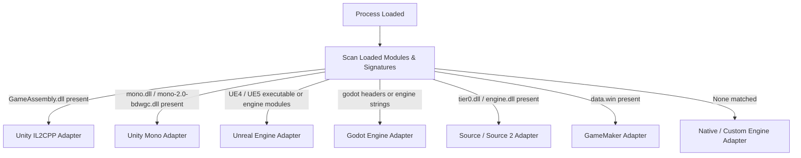

# ReFix Engine Adapters Reference

The ReFix Mods runtime provides native engine abstraction adapters in `src/mods/adapters/engine/`. These adapters automatically detect the game engine, normalize lifecycle phases, provide engine-specific hooks, and guarantee compatibility across both **x64** and **x86** architectures.

---

## 1. Engine Detection & Initialization

During the `Boot` and `GameInit` phases, ReFix scans loaded modules, PE export tables, and game directory structures to identify the underlying engine runtime.

---

## 2. Supported Engines & Capabilities

### 2.1 Unity IL2CPP (`REFIX_ENGINE_UNITY_IL2CPP`)
- **Detection Criteria:** Presence of `GameAssembly.dll` in memory or the `il2cpp_data` directory.
- **Hook Anchors:**
  - `il2cpp_init`: Dispatched before managed domain initialization.
  - `il2cpp_runtime_invoke`: Allows intercepting managed method execution.
- **Memory Conventions:**
  - x64: Standard Windows x64 calling convention (`RCX`, `RDX`, `R8`, `R9`).
  - x86: `__cdecl` or `__stdcall` depending on method signature.
- **Common Use Cases:** Patching game logic, bypassing offline timeout checks, fixing network initialization race conditions.

### 2.2 Unity Mono (`REFIX_ENGINE_UNITY_MONO`)
- **Detection Criteria:** Loaded `mono-2.0-bdwgc.dll` or `mono.dll`.
- **Hook Anchors:**
  - `mono_jit_init_version`: Domain initialization.
  - `mono_runtime_invoke`: Managed method invocation.
- **Capabilities:**
  - Memory patch support on JIT-compiled code via declarative patches.
  - Interception of `Assembly-CSharp.dll` methods.

### 2.3 Unreal Engine 4 & 5 (`REFIX_ENGINE_UNREAL_4`, `REFIX_ENGINE_UNREAL_5`)
- **Detection Criteria:** Presence of Unreal Engine strings, `CoreUObject.dll`, or `UE4Game-Win64-Shipping.exe` / `UE5Game` binary naming patterns.
- **Hook Anchors:**
  - `FEngineLoop::Init`: Engine subsystems initialized.
  - `UWorld::Tick`: Synchronized frame updates.
- **LAN Multi-Instance:** Automatically synchronizes with ReFix LAN multi-instance slot assignment to allow testing multiple game instances on the same PC.

### 2.4 Godot Engine (`REFIX_ENGINE_GODOT`)
- **Detection Criteria:** Godot binary exports, `project.binary`, or `godot.windows` strings.
- **Hook Anchors:**
  - `Main::setup`: Engine configuration loaded.
  - `Main::start`: Game scene tree enters active execution.

### 2.5 Valve Source & Source 2 (`REFIX_ENGINE_SOURCE`, `REFIX_ENGINE_SOURCE_2`)
- **Detection Criteria:** Presence of `tier0.dll`, `vstdlib.dll`, or `engine.dll`.
- **Calling Conventions:**
  - 32-bit Source games (e.g., Left 4 Dead 2, Portal 2, TF2) use `__thiscall` extensively for engine interfaces. The ReFix adapter provides thiscall-correct trampolines.
- **Hook Anchors:**
  - `CBaseClient::Connect`: Game connecting to multiplayer server.
  - `CNetChan::ProcessPacket`: Raw network packet dispatch.

### 2.6 GameMaker (`REFIX_ENGINE_GAMEMAKER`)
- **Detection Criteria:** Presence of `data.win` or GameMaker runtime exports.
- **Hook Anchors:** Script execution trampolines for GameMaker language (GML) functions.

### 2.7 Native / Custom Engines (`REFIX_ENGINE_NATIVE`)
- **Detection Criteria:** Fallback adapter when no standard commercial engine is detected.
- **Hook Anchors:** Direct PE module RVA patches, WinMain / DllMain interception, and Windows message loop hooks (`PeekMessageW`, `DispatchMessageW`).

---

## 3. Architecture Compatibility: x64 vs x86

ReFix Mods provides feature parity between 64-bit and 32-bit games:

| Feature | 64-bit (x64) | 32-bit (x86) |
|---|---|---|
| **Pointer Size** | 8 bytes (`uint64_t`) | 4 bytes (`uint32_t`) |
| **Sandboxed WASM** | `wasm3` 64-bit interpreter | `wasm3` 32-bit interpreter |
| **Hook Engine** | MinHook x64 (`hde64`) | MinHook x86 (`hde32`) |
| **Calling Conventions** | Microsoft x64 standard ABI | `__cdecl`, `__stdcall`, `__thiscall`, `__fastcall` |
| **Memory Write Checks** | Validates 64-bit ROP addresses | Validates 32-bit ROP addresses |

### Handling Calling Conventions on x86
On 32-bit engines, mismatched calling conventions (e.g., forgetting that an engine function is `__thiscall` where `ECX` holds the `this` pointer) cause stack corruption. ReFix Mediated Hooks automatically preserve all register states (`EAX`, `ECX`, `EDX`, `EBX`, `ESI`, `EDI`) before invoking WASM callbacks, guaranteeing stack balance upon return.
