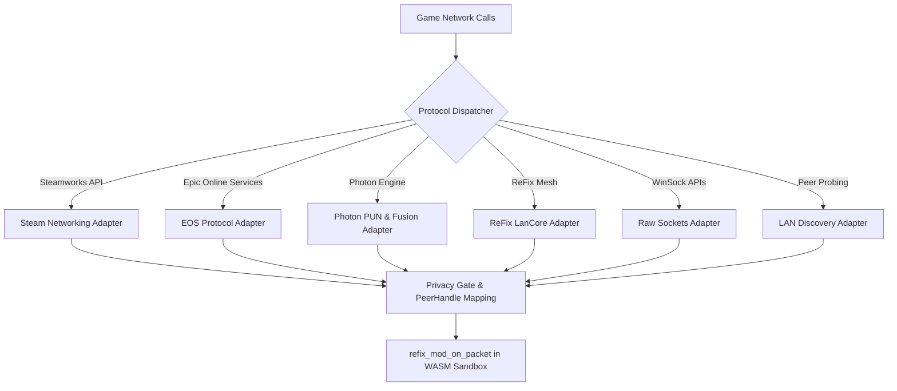

# ReFix Protocol Adapters Reference

The ReFix Mods SDK includes network protocol adapters in `src/mods/adapters/protocol/`. These adapters mediate all game networking protocols, enabling mods to inspect, modify, redirect, or rewrite network traffic across engines while strictly maintaining player privacy.

---

## 1. Supported Network Protocols



---

## 2. Protocol Details

### 2.1 Steam Networking (`REFIX_PROTO_STEAM_NETWORKING`, `REFIX_PROTO_STEAM_SOCKETS`)
- **Interfaces Hooked:**
  - `ISteamNetworking`: Legacy P2P packet exchange (`SendP2PPacket`, `ReadP2PPacket`, `IsP2PPacketAvailable`).
  - `ISteamNetworkingSockets`: Modern connection-oriented Steam Datagram Relay (SDR) and messages (`SendMessageToConnection`, `ReceiveMessagesOnConnection`).
  - `ISteamMatchmaking`: Lobby creation, search, and member metadata.
- **Mod Interception Capabilities:**
  - Channel filtering: Mods can declare specific channels (e.g. channel 0 for gameplay, channel 1 for voice).
  - Packet injection: Mods can dispatch custom game messages using `host->send_packet`.
  - P2P session rerouting: Redirects game traffic over the ReFix LAN transport automatically.

### 2.2 Epic Online Services (`REFIX_PROTO_EOS_P2P`, `REFIX_PROTO_EOS_SESSIONS`)
- **Interfaces Hooked:**
  - `EOS_P2P_SendPacket` and `EOS_P2P_ReceivePacket`.
  - `EOS_Lobby` and `EOS_Sessions`.
- **Handling:**
  - Maps opaque EOS Product User IDs (PUID) to ephemeral `PeerHandle` values.
  - Intercepts NAT traversal / ICE negotiation packets to route directly over LAN.

### 2.3 Photon PUN & Fusion (`REFIX_PROTO_PHOTON_PUN`, `REFIX_PROTO_PHOTON_FUSION`)
- **Protocols Supported:**
  - **Photon PUN 1.8**: Binary protocol with command headers, reliability sequencing, and channels.
  - **Photon Fusion**: Shared-mode network simulation server built into ReFix LAN.
- **Handling:**
  - Unpacks Photon command envelopes to expose game-level event payloads to mods.
  - Allows mods to rewrite custom RPC events or sync rates.

### 2.4 ReFix LanCore (`REFIX_PROTO_LAN_CORE`)
- **Description:** ReFix's universal, zero-configuration peer-to-peer mesh transport.
- **Features:**
  - Dual-socket architecture (unicast + multicast).
  - Automatic fragmentation and reassembly (supporting payloads up to 64 KB).
  - Selective repeat ARQ for reliable delivery.
  - Inactivity window tracking and stale peer cleanup.

### 2.5 Raw Sockets (`REFIX_PROTO_RAW_SOCKETS`)
- **Interfaces Hooked:**
  - Windows Sockets (`ws2_32.dll`): `sendto`, `recvfrom`, `WSASendTo`, `WSARecvFrom`, `connect`.
- **Handling:**
  - Intercepts games using raw UDP/TCP protocols without standard SDKs.
  - Encapsulates payloads into LanCore mesh packets and presents them as `(PeerHandle, channel_id)` tuples.

### 2.6 LAN Discovery Layer (`REFIX_PROTO_DISCOVERY`)
- **Description:** Multicast peer discovery operating on `239.255.71.84` across ports `47584` through `47594`.
- **Capabilities:**
  - Filters broadcast storms.
  - Detects multi-instance game sessions on the same subnet.

---

## 3. The Mod Packet Interception Pipeline

When a mod registers a packet filter, ReFix invokes the mod's `refix_mod_on_packet` callback:

```c
REFIX_MOD_EXPORT int32_t refix_mod_on_packet(
    uint32_t protocol_type,
    uint64_t peer_handle,
    uint32_t channel,
    const uint8_t* data,
    size_t len,
    uint8_t* out_modified_data,
    size_t* inout_modified_len
);
```

### Action Return Codes:
- `0` (`REFIX_PACKET_ACTION_PASS`): The packet is forwarded to the game or network without modification.
- `1` (`REFIX_PACKET_ACTION_MODIFY`): The original payload is replaced with the bytes in `out_modified_data` (up to `*inout_modified_len` bytes).
- `2` (`REFIX_PACKET_ACTION_DROP`): The packet is silently dropped and never reaches the game or the network.

---

## 4. Future P2P / WAN Migration Path

The ReFix Mods Network API was designed specifically so that migrating from local LAN multicast to future encrypted P2P tunnels (e.g., WireGuard, WebRTC, STUN/TURN) requires **zero changes** to existing community mods:
1. Mods never interact with `sockaddr`, IP addresses, or network interfaces.
2. The translation between `PeerHandle` and physical endpoints resides entirely within `lan_core`.
3. When WAN P2P transports are enabled, the ReFix host updates its internal routing table; all mod code continues functioning identically.
