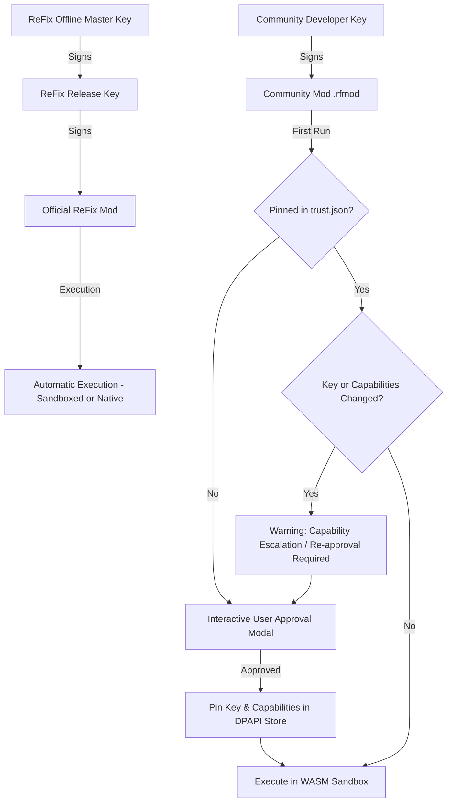

# ReFix Mods Security Architecture & Threat Model

This document specifies the security guarantees, mathematical models, defensive mechanisms, and cryptographic architectures underlying the **ReFix Mods SDK**.

---

## 1. Threat Model & Security Objectives

### 1.1 Threat Actors
1. **Malicious Mod Author:** Attempts to distribute malware, ransomware, token stealers, or botnet agents disguised as game mods.
2. **Compromised Distribution Channel / Mirror:** Attempts to inject malicious binaries into legitimate `.rfmod` packages during transit or hosting.
3. **Malicious Mod Update:** Attempts to escalate capabilities silently after gaining initial user trust.
4. **Adversarial Network Peer:** Attempts to exploit packet parsing vulnerabilities or track physical players across multiplayer matches.
5. **Vulnerable / Buggy Community Mod:** Accidentally enters an infinite loop, divides by zero, corrupts game memory, or exhausts system RAM.

### 1.2 Core Security Objectives
- **Zero Host Compromise:** Community mods must never be able to execute arbitrary Win32 APIs, launch processes, modify system files, access the Windows registry, or establish unauthorized network connections.
- **Strict Player Privacy:** Remote players' physical identities (IP, port, MAC, real SteamID, real EOS ID) must never cross the mod boundary under any circumstances.
- **Fail-Safe Fault Isolation:** Mod crashes or infinite loops must never crash the host game or compromise session stability.
- **Cryptographic Provenance:** Every mod must be cryptographically signed, verified before load, and pinned to prevent silent key rotation.

---

## 2. Requirement S1: Player Privacy & The Privacy Gate

### 2.1 The Problem
In standard peer-to-peer and LAN game architectures, game packets expose the physical IP address, port, and persistent account identifier (such as 64-bit SteamID or EOS Product User ID) of every player in the session. A malicious or telemetry-gathering mod could log this data to map players' physical locations, build cross-game tracking databases, or orchestrate targeted DDoS attacks.

### 2.2 Mathematical Formalization of Ephemeral Peer Handles
ReFix eliminates this vector by passing opaque `PeerHandle` values to mods. Each `PeerHandle` is generated using a double-salted HMAC:

$$\text{PeerHandle} = \text{Truncate64}\Big(\text{HMAC-SHA256}\big(\text{SessionSalt} \oplus \text{ModSalt}, \;\; \text{RealID}\big)\Big)$$

Where:
- $\text{SessionSalt} \in \{0, 1\}^{256}$ is a cryptographically secure random number generated fresh at the start of each game session using Windows `BCryptGenRandom` or `CryptGenRandom`.
- $\text{ModSalt} = \text{SHA256}(\text{ModID})$ is a deterministic 256-bit hash of the specific mod's unique identifier.
- $\oplus$ represents bitwise XOR.
- $\text{RealID}$ is the 64-bit SteamID or raw EOS PUID of the remote peer.
- $\text{Truncate64}(X)$ extracts the lower 64 bits of the 256-bit HMAC digest.

#### Cryptographic Properties:
1. **Cross-Mod Unlinkability:**
   Given two mods $A$ and $B$ running concurrently in the same session, $\text{PeerHandle}_A \neq \text{PeerHandle}_B$ for the same physical player. Neither mod can correlate its player list with the other.
2. **Cross-Session Unlinkability:**
   When the player restarts the game or joins a new match, a fresh $\text{SessionSalt}$ is generated. A mod cannot track a player across sessions or build long-term behavioral profiles.
3. **Pre-image & Identity Resistance:**
   Because HMAC-SHA256 is computationally non-invertible and the 256-bit salts remain strictly inside the ReFix host runtime, it is mathematically infeasible for a mod to derive $\text{RealID}$, IP addresses, or MAC addresses from a `PeerHandle`.

### 2.3 Physical Address Firewalling
The low-level transport layer (`lan_core`) maintains the translation table between physical `sockaddr_in` endpoints and `PeerHandle` values. The mod SDK provides no host APIs that take or return IP addresses or socket descriptors. All network operations are addressed exclusively to `(PeerHandle, channel_id)`.

### 2.4 Display Name Masking
Player visible names are considered sensitive personal data. By default:
- Remote peers are identified as anonymous pseudonyms formatted as `Player_XXXX` (where `XXXX` is a 4-character hex substring of their ephemeral `PeerHandle`).
- Only if the mod explicitly declares the `players.display_name` capability, and the user explicitly grants approval in the ReFix Overlay, does the host return the actual display name.

---

## 3. Requirement S2: System Isolation & 2-Tier Execution

### 3.1 Technical Reality of In-Process Execution
A native Win32 DLL (`.dll`) loaded into a game process has unrestricted access to the entire virtual address space of the process and can invoke arbitrary Windows API syscalls (`CreateProcess`, `URLDownloadToFile`, `RegSetValue`, etc.). **There is no reliable operating-system boundary that can prevent a native in-process DLL from calling Win32 APIs.**

Consequently, ReFix Mods implements a strict two-tier architecture:

| Tier | Format | Permitted Authors | Isolation Boundary |
|---|---|---|---|
| **Sandboxed** *(Default)* | WebAssembly bytecode (`.wasm`) | **All Community Developers** | **True Boundary:** Interpreted by statically linked `wasm3`. Zero system calls, zero Win32 APIs, memory bounded. |
| **Native** | Win32 PE Dynamic Link Library (`.dll`) | **ReFix Official Team Only** | **Cryptographic Trust Only:** Signed strictly by the ReFix Master Offline Key. Community native mods are rejected. |

### 3.2 WebAssembly Sandbox Construction
- **Zero WASI Imports:** The runtime does not link `wasi_snapshot_preview1` filesystem, socket, or process functions.
- **Explicit Host API Surface:** The only functions callable from WASM are explicit C functions exported by the ReFix host (e.g., `refix_log`, `refix_storage_read`, `refix_register_patch`).
- **Capability Check on Every Invocation:** Every host function verifies that the calling mod's approved capability mask contains the required permission bit before executing.
- **Resource Quotas:**
  - Linear Memory: Hard-capped per mod (default 16 MB, maximum 64 MB).
  - Storage Quota: Isolated per mod in `%APPDATA%\ReFix\mods\data\<mod_id>\` (capped at 1024 KB).
  - Watchdog Timer: Callbacks are monitored using high-resolution hardware timers (`QueryPerformanceCounter`). Any callback exceeding 15 ms is terminated.

### 3.3 Declarative Patch Engine (Mitigating Code Injection)
To allow game fixes without granting executable memory creation rights:
1. **No `VirtualProtect` in Mods:** Sandboxed mods cannot alter memory page permissions or mark pages `PAGE_EXECUTE_READWRITE`.
2. **Declarative Definitions:** Patches are submitted as static data structures:
   $$\text{Patch} = \{\text{Module}, \;\; \text{RVA}, \;\; \text{ExpectedBytes}, \;\; \text{NewBytes}\}$$
3. **Module Blacklisting:** ReFix actively rejects any patch targeting:
   - Operating system libraries: `kernel32.dll`, `ntdll.dll`, `user32.dll`, `ws2_32.dll`, `advapi32.dll`, `shell32.dll`, etc.
   - ReFix internal runtime modules: `winmm.dll`, `steam_api64.dll`, `EOSSDK-Win64-Shipping.dll`, etc.
4. **State Verification:** ReFix compares the bytes currently in memory with `ExpectedBytes`. If the game version differs or another mod has modified the region, the patch is aborted cleanly.
5. **Automatic Rollback:** If a mod encounters an unhandled trap or is unloaded, the host automatically restores `ExpectedBytes` to memory.

### 3.4 Anti-ROP & Memory Write Protections
For mods requiring the `memory.write` capability (e.g., adjusting game variables, FOV, or heap data):
- **IAT / EAT / PE Header Protection:** ReFix blocks writes that overlap module headers, Import Address Tables, or Export Address Tables.
- **ROP Gadget Mitigation:** All written byte buffers are scanned. If any written 64-bit or 32-bit word represents an address located inside an executable code section of any system DLL, the write is immediately rejected.
- **Honest Security Boundary:** While these checks mitigate typical Return-Oriented Programming (ROP) attacks and pointer hijacking, direct memory writes into game heap memory inherently carry risk. Therefore, `memory.write` is classified as **High Risk** and displayed with prominent warning banners in the user approval interface.

---

## 4. Requirement S3: Cryptography & The Trust Store

### 4.1 Cryptographic Algorithms
- **Signatures:** Ed25519 (Edwards-curve Digital Signature Algorithm over Curve25519), implemented via an audited, statically linked Monocypher library.
- **Hashing:** SHA-256 for file digests and manifest integrity.
- **Canonical Serialization:** Manifests are serialized to canonical JSON (sorted keys, no whitespace) prior to signing to guarantee deterministic digests across platforms.

### 4.2 Trust Hierarchy & Key Pinning (TOFU)

### 4.3 DPAPI-Encrypted Trust Store
The approval database is stored at:
`%APPDATA%\ReFix\mods\trust.json`

To prevent external processes or malware from silently granting capabilities:
1. **Encryption at Rest:** The entire JSON store is encrypted using Windows Data Protection API (`CryptProtectData`), binding the plaintext to the user's Windows login credentials.
2. **HMAC Integrity Tag:** An HMAC-SHA256 signature is calculated over the ciphertext using a runtime-derived secret. Any manual tampering, truncation, or corruption of `trust.json` causes decryption to fail safely, forcing a clean reset.

### 4.4 Revocation List
ReFix ships with an embedded cryptographic revocation list (`RevocationList`) containing known compromised author public keys and SHA-256 package hashes. Even if a revoked mod was previously approved by the user, the loader checks the revocation list prior to scheduling and refuses execution.
